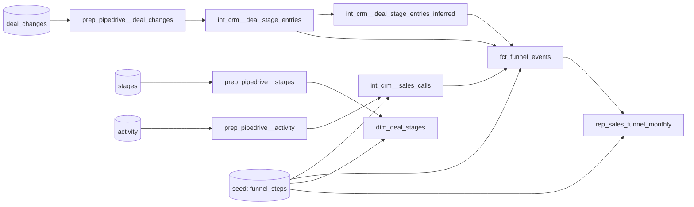

# Solution: Pipedrive sales funnel

`rep_sales_funnel_monthly` reports, for each month and each of the 11 funnel steps, how many distinct deals reached that step. Columns: `month`, `kpi_name`, `funnel_step`, `deals_count`. The profiling behind the design is in [exploratory_analysis.md](exploratory_analysis.md).

## Data caveats

Four things in the data don't behave like a typical sales pipeline. Each one changes what the numbers mean, so I'd confirm them with the CRM owner before the report is used for decisions.

- **Sales calls don't link to deals.** Only 8 of 4,572 activity `deal_id`s exist in `deal_changes`, about what chance gives. Steps 2.1 and 3.1 therefore count calls, not funnel deals, and can't be read as conversion from the stage steps. ([08](../analyses/08_activity_deal_overlap.sql), open question 4)
- **About half of the mid-funnel is inferred.** 84% of deals skip at least one stage, and no deal has all 9 stages recorded. With skipped stages counted as entered, about half of the deals in Negotiation (53% recorded), Closing (52%) and Onboarding (54%) never had that stage logged. The backfilled funnel looks clean; the recorded process doesn't. ([10](../analyses/10_stage_coverage.sql), open questions 2 and 7)
- **Lead Generation comes a month after creation, and creation isn't a step.** Deals enter stage 1 a median of 35 days after they're created, although a Pipedrive deal normally has a stage from the moment it exists. Deal creation (205–262 deals per month in Jan–Aug 2024) is the input volume for the whole funnel, but the README's 11 steps don't include it. ([09](../analyses/09_creation_vs_stage_1.sql), open question 6)
- **Every deal ends lost, with a near-random reason.** Even the 324 deals that reached Renewal/Expansion have a lost reason, and the five reasons are almost evenly split. The funnel can't separate won from lost deals. ([05](../analyses/05_lost_reasons.sql))

## How to run

```bash
docker compose up -d
python -m venv .venv && .venv/bin/pip install -r requirements.txt
.venv/bin/dbt build --profiles-dir .      # seeds, models, unit/data tests, contract
```

`docker compose up` creates the raw tables in `public` and loads `raw_data/*.csv` (`init.sql`, `raw_data/load_data.sh`). `profiles.yml` lives in the repo root, hence `--profiles-dir .`.

The output is `public_reporting_crm.rep_sales_funnel_monthly`: 2024-01 to 2025-02, 14 months × 11 steps = 154 rows.

## Lineage



| Layer | Prefix | Materialization | Schema | Role |
|---|---|---|---|---|
| Preparation | `prep_pipedrive__` | view | `public_preparation_pipedrive` | 1:1 with the source: rename and cast only |
| Intermediate | `int_crm__` | view* | `public_intermediate_crm` | Business logic: stage entries, inferred (skipped) stages, sales calls |
| Marts | `dim_` / `fct_` | table | `public_marts_crm` | `fct_funnel_events`: one row per deal × funnel event, reusable beyond this report |
| Reporting | `rep_` | table | `public_reporting_crm` | Report-shaped output, built only from marts. Enforced contract. |

\* `int_crm__deal_stage_entries` is a table: the funnel reads it directly and through the inferred-stages model, so its window function runs once. Folder defaults live in `dbt_project.yml`, and per-model exceptions live in the folder's yml.

Conventions: import CTEs, then logic CTEs, then `final`. Columns are explicit and lower-case. Ids are `<entity>_id`, timestamps `<verb>_at`, booleans `is_`/`has_`. Surrogate keys use the null-safe `md5(concat_ws(...))`. No packages.

## Key decisions

| Decision | Why | Alternative (how to switch) |
|---|---|---|
| **Skipped stages count as entered.** A 1→3 move also counts stage 2. | 84% of deals skip stages; this matches Pipedrive Insights' funnel convention. The inferred rows live in their own model, flagged `is_inferred`. | Actual entries only: `where not is_inferred` on `fct_funnel_events` |
| **Lead Generation counts stage 1 entries**, not deal creation. | Every stage step is then a stage entry, and step 1 maps to stage 1 like steps 2–9 map to theirs. Deals enter stage 1 a median of 35 days after creation. | Count step 1 by `add_time`: add creation events to `fct_funnel_events` for step 1. |
| **Event-month counting**: deals with an event for the step in that month. | A monthly view of funnel activity. A deal reaching several steps in a month counts in each. | Cohort by created month, or cumulative "reached ≥ step". Both can be built from `fct_funnel_events`. |
| **Steps 2.1 and 3.1 count sales calls from `activity`**, done or not, by `due_to` month. | Activity `deal_id`s don't link to deals: the 8 of 4,572 that match are what chance predicts. Joining them would keep only those coincidences, and leaving the steps empty would drop a signal the README asks for; standalone calls keep the real call volume. Calls that weren't done still show scheduled sales demand (the split is about 50/50). `due_to` is the only timestamp. | Done calls only: `where is_done`. Once an id mapping exists, join the calls to deals. |
| **Funnel steps are defined in a seed.** | The README fixes the numbering and names. Steps 2.1 and 3.1 are activities, not stages; the seed also decides which activity types count as sales calls. | A new pipeline stage without a seed row fails the build (not_null tests on `dim_deal_stages`). |
| **The 5 deal_ids with two creations are treated as one deal.** Lost reason doesn't remove deals. | Their two histories run in parallel, so no split heuristic is reliable, and every deal has a lost reason. | Revisit once stakeholders confirm what they represent. |
| **Dense grid**, with 0 for months without deals. | Gaps are explicit, and dashboards don't need to fill them. | Sparse rows |
| **Pipeline order = `stage_id` order** (assumption used by the backfill). | Pipedrive orders stages by `order_nr`, which isn't in the export; ids 1–9 follow the README funnel. | Order by `order_nr` once it's exported. |

## How to read the report

Read it together with the [data caveats](#data-caveats).

- Counts are by **event month**, so a later step can exceed an earlier one in the same month. Over the whole period, the deals reaching each step only shrink (1,995 at step 1 down to 324 at step 9).
- **Lead Generation lags creation**: 2024-01 shows 30 deals entering stage 1, although 247 deals were created that month.
- **Steps 2.1 and 3.1 are on a different basis**: 2024-01 has 148 Sales Call 1 against 30 Lead Generation, because each call carries its own unlinked `deal_id`.
- **Activity data ends in 2024-09**, so steps 2.1 and 3.1 are 0 from 2024-10. Deal creation also ends in 2024-09, so later months show deals finishing their path.

## Tests

- **Source:** not_null, unique, accepted_values, relationships. `activity_id` uniqueness only warns; it's a known issue.
- **Generic:** keys, funnel steps and names in each layer.
- **Unit:** the backfill rule (1→3→5 infers 2 and 4; adjacent, backward and single-stage moves infer nothing) and `previous_stage_id` ordering.
- **Singular:** stage entries reconcile with the source; inferred stages lie below the reached stage; report grain.
- **Contract:** column names and types of the report.
- **Not empty:** a small generic test (`tests/generic/not_empty.sql`) on the sources feeding the report and on the report. Key and grain tests pass on an empty table, so this is the only check that catches an empty load.

## Open questions for stakeholders

1. Who uses the report, and for what (throughput vs. conversion)? This decides event-month vs. cohort counting.
2. Should skipped stages count as entered? (Assumed yes.)
3. What do the 5 deal_ids with two creations represent: merged deals, duplicates, or something else?
4. The activity export seems to use a different deal id space: can we get the mapping to `deal_changes`?
5. Should calls that weren't done count?
6. Is deal creation the top-of-funnel number the business tracks? If so, Lead Generation could count creations, or a "Deals created" KPI could sit next to the funnel.
7. Are stages optional in the sales process, or is the stage log incomplete? Almost every deal skips stages.

## Extensions: deal-level marts

These models aren't needed for the report. They are reusable entities for other analyses, and are delivered separately from the main PR.

| Model | Grain | Notes |
|---|---|---|
| `int_crm__deal_current_state` | deal | Latest value per field from the change log: `distinct on (deal_id, changed_field_key)` plus a pivot. Gives owner, current stage, lost reason and lost_at, plus created_at and counts. |
| `fct_deals` | deal | Current state plus stage aggregates (entered, skipped, max), first and last stage dates, lost reason name, `deal_duration_days` (created → lost), and `has_multiple_creations` (flags the 5 ids with two creations). After a backward move, a stage can count as both skipped and entered. |
| `fct_deal_stage_history` | actual stage entry | `next_stage_id`, `exited_at`, `days_in_stage`, `is_current_stage`. |
| `fct_sales_calls` | activity row | Sales calls with their funnel step and activity type name. Keyed on `sales_call_id`, because `activity_id` isn't unique. |
| `dim_crm_users` | user | Deal owners and activity assignees. It's named by domain, not source, so it survives a CRM change. |

With these models `int_crm__deal_stage_entries` has four readers, which further justifies materializing it as a table. A singular test checks that durations are never negative.

Next steps not built yet:
- a "Deals created" KPI (from `add_time`) next to the funnel, depending on open question 6;
- conversion and cohort funnels from `fct_funnel_events`;
- incremental loads: the window functions need each deal's full history, so an incremental `int_crm__deal_current_state` (or stage entries) would pick up the deal_ids changed since the last run, recompute them fully and merge on `deal_id`. Not worth it at 15k rows;
- source freshness;
- a shared calendar model (month spine with quarter and fiscal attributes) once more time-based reports exist, or if the report should run up to the current month. Today the month range comes from the data.
