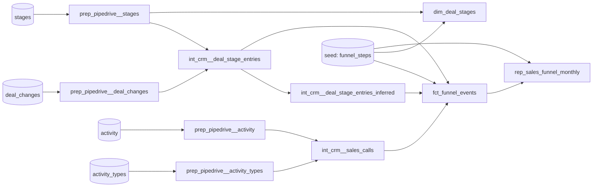

# Solution: Pipedrive sales funnel

`rep_sales_funnel_monthly` reports, for each month and each of the 11 funnel steps, how many distinct deals reached that step. Columns: `month`, `kpi_name`, `funnel_step`, `deals_count`. The profiling behind the design is in [exploratory_analysis.md](exploratory_analysis.md).

## How to run

```bash
docker compose up -d
python -m venv .venv && .venv/bin/pip install -r requirements.txt
.venv/bin/dbt build --profiles-dir .      # seeds, models, unit/data tests, contract
```

The output is `public_reporting_crm.rep_sales_funnel_monthly`: 2024-01 to 2025-02, 14 months × 11 steps = 154 rows.

## Lineage



| Layer | Prefix | Materialization | Schema | Role |
|---|---|---|---|---|
| Preparation | `prep_pipedrive__` | view | `public_preparation_pipedrive` | 1:1 with the source: rename and cast only |
| Intermediate | `int_crm__` | view* | `public_intermediate_crm` | Business logic: stage entries, inferred (skipped) stages, sales calls |
| Marts | `dim_` / `fct_` | table | `public_marts_crm` | `fct_funnel_events`: one row per deal × funnel event, reusable beyond this report |
| Reporting | `rep_` | table | `public_reporting_crm` | Report-shaped output, built only from marts. Enforced contract. |

\* `int_crm__deal_stage_entries` is a table: the funnel reads it directly and through the inferred-stages model, so its window function runs once. Folder defaults live in `dbt_project.yml`, and per-model exceptions live in the folder's yml.

Conventions: import CTEs, then logic CTEs, then `final`. Columns are explicit and lower-case. Ids are `<entity>_id`, timestamps `<verb>_at`, booleans `is_`/`has_`. Surrogate keys use the null-safe `md5(concat_ws(...))`. No packages.

## Key decisions

| Decision | Why | Alternative (how to switch) |
|---|---|---|
| **Skipped stages count as entered.** A 1→3 move also counts stage 2. | 84% of deals skip stages; this matches Pipedrive Insights' funnel convention. The inferred rows live in their own model, flagged `is_inferred`. | Actual entries only: `where not is_inferred` on `fct_funnel_events` |
| **Event-month counting**: deals with an event for the step in that month. | A monthly view of funnel activity. A deal reaching several steps in a month counts in each. | Cohort by created month, or cumulative "reached ≥ step". Both can be built from `fct_funnel_events`. |
| **Sales calls count whether done or not**, from `activity` alone, by `due_to` month. | Activities can't be joined to deals (8 of 4,572 overlap), and `due_to` is the only timestamp. | Done calls only: `where is_done` |
| **Funnel steps are defined in a seed.** | The README fixes the numbering and names. Steps 2.1 and 3.1 are activities, not stages. | A new pipeline stage without a seed row fails the build (not_null tests on `dim_deal_stages`). |
| **The 5 deal_ids with two creations are treated as one deal.** Lost reason doesn't remove deals. | Their two histories run in parallel, so no split heuristic is reliable, and every deal has a lost reason. | Revisit once stakeholders confirm what they represent. |
| **Dense grid**, with 0 for months without deals. | Gaps are explicit, and dashboards don't need to fill them. | Sparse rows |

## How to read the report

- Counts are by **event month**, so a later step can exceed an earlier one in the same month.
- **Steps 2.1 and 3.1 are a separate population**: the activities don't link to the deals. For example, 2024-01 has 148 Sales Call 1 against 30 Lead Generation.
- **Activity data ends in 2024-09**, so steps 2.1 and 3.1 are 0 from 2024-10. Deal creation also ends in 2024-09, so later months show deals finishing their path.

## Tests

- **Source:** not_null, unique, accepted_values, relationships. `activity_id` uniqueness only warns; it's a known issue.
- **Generic:** keys, funnel steps and names in each layer.
- **Unit:** the backfill rule (1→3→5 infers 2 and 4; adjacent, backward and single-stage moves infer nothing) and `previous_stage_id` ordering.
- **Singular:** stage entries reconcile with the source; inferred stages lie below the reached stage; report grain.
- **Contract:** column names and types of the report.

## Open questions for stakeholders

1. Who uses the report, and for what (throughput vs. conversion)? This decides event-month vs. cohort counting.
2. Should skipped stages count as entered? (Assumed yes.)
3. What do the 5 deal_ids with two creations represent: merged deals, duplicates, or something else?
4. Why don't activity `deal_id`s match `deal_changes`?
5. Should calls that weren't done count?

## Possible extensions

These are implemented on the stacked branch `feature/deal-marts-extensions`, kept out of this PR to keep it focused:
- `fct_deals`: one row per deal (owner, current and max stage, stages skipped, lost reason, duration), built from an `int_crm__deal_current_state` model.
- `fct_deal_stage_history`: time spent in each stage.
- `fct_sales_calls` and `dim_crm_users`.

Next steps not built yet:
- conversion and cohort funnels from `fct_funnel_events`;
- incremental loads (recompute only the deals changed since the last run, then merge);
- source freshness.
